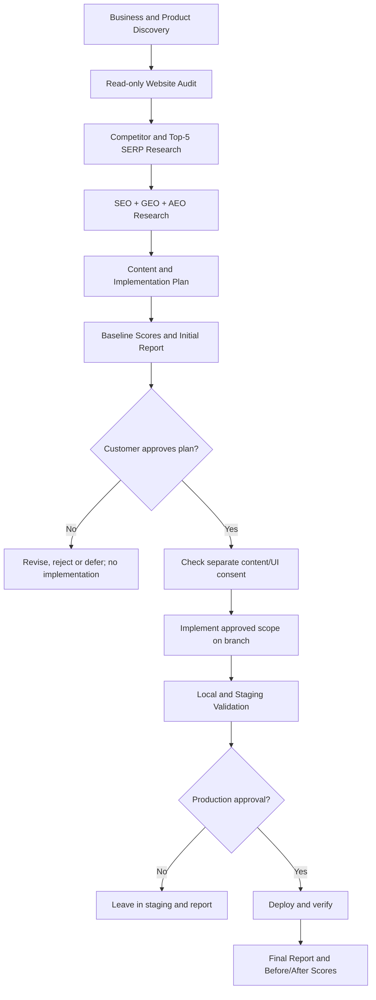

# Search Visibility Agent Skills

**An open-source, research-first Agent Skills toolkit for SEO, GEO and AEO.**

Search Visibility Agent Skills helps compatible AI coding agents assess an existing website, understand the business behind it, research competitors and search results, prepare evidence-based optimization plans, and — only after explicit approval — implement and validate authorized changes.

> **Core promise:** Improve search visibility without silently redesigning the customer's website or rewriting visible content.

[](#compatibility)
[](#what-it-does)
[](#what-it-does)
[](#what-it-does)
[](LICENSE)

---

## Why this project?

Most SEO workflows jump straight into editing titles, headings and page copy. This project takes a different approach:

1. Understand the customer's business, product, audience and goals.
2. Audit the existing website and establish a measurable baseline.
3. Identify business, search, content and product competitors.
4. Research the top five organic results for each agreed priority query.
5. Develop separate SEO, GEO and AEO strategies.
6. Prepare complete, original, business-specific content proposals.
7. Present an evidence-backed plan and baseline scores.
8. Wait for explicit approval before implementation.
9. Preserve the existing UI and obtain separate consent for visible content or design changes.
10. Validate approved changes and produce a before/after report.

## What it does

| Capability | Scope |
|---|---|
| Business discovery | Understand products, services, audiences, differentiators, geography and conversion goals |
| Website audit | Crawlability, indexation, metadata, content, internal links, performance and structured data |
| Competitor intelligence | Separate business/search/content/product competitors and analyze top-five organic results |
| SEO | Keyword intent, page mapping, technical fixes, content gaps and internal linking |
| GEO | Entity clarity, factual consistency, source quality and measured AI answer/citation observations |
| AEO | Question research, direct answers, answer structure and eligible structured data |
| Content planning | Prepare page-level copy, metadata, FAQs, headings and JSON-LD proposals |
| Safe implementation | Apply only approved changes in a branch, with validation and rollback |
| Reporting | Initial audit and final before/after SEO, GEO and AEO scores out of 10 |

## The operating workflow



## Non-negotiable UI and consent policy

**This is an optimization agent, not a redesign agent.**

The default protected scope includes:

- CSS, SCSS, design tokens and styling frameworks.
- Layouts, spacing, colors, fonts and responsive breakpoints.
- Components, navigation, headers, footers, buttons and forms.
- Animations, transitions and existing interactions.
- Existing visible text, product descriptions, headings and CTAs.
- Application logic, routes, APIs, authentication and conversion flows.

The agent must follow these approval gates:

| Action | Consent required |
|---|---|
| Audit and research | No implementation consent; read-only access must be authorized |
| Non-visible technical SEO changes | Explicit approval in the versioned implementation plan |
| Visible text/content changes | Separate approval of exact proposed text and URL/section |
| UI/design/layout/component changes | Separate approval of exact scope and affected pages |
| Production deployment | Separate approval of the tested release |

Silence is not consent. General instructions such as "make my website SEO-ready" are not permission to rewrite content or redesign the site. Unapproved items must remain untouched and appear in the report as pending or deferred.

## Transparent scoring

The toolkit scores three separate dimensions from **0.0 to 10.0**:

- **SEO readiness:** crawlability, technical foundations, on-page content, internal linking, performance evidence, structured data, authority evidence and measurement readiness.
- **GEO readiness:** entity clarity, factual completeness, source quality, topical coverage, citation-ready claims, technical accessibility, third-party corroboration and measured AI visibility.
- **AEO readiness:** question research, answer quality, extractability, question coverage, evidence, appropriate schema, readability and measured answer visibility.

The same rubric and comparable scope must be used before and after implementation. Reports show evidence coverage and confidence. Missing evidence is marked **Not assessed**, not invented.

**A readiness score is not a Google ranking, AI citation guarantee, traffic forecast or conversion result.** Actual search performance must be monitored over time.

## Repository structure

```text
search-visibility-agent-skills/
├── .agents/
│   └── skills/
│       ├── seo-orchestrator/
│       ├── business-discovery/
│       ├── website-audit/
│       ├── competitor-research/
│       ├── seo-research/
│       ├── geo-research/
│       ├── aeo-research/
│       ├── content-generation/
│       ├── implementation/
│       ├── consent-management/
│       ├── scoring-engine/
│       ├── production-validation/
│       └── report-generation/
├── policies/
│   ├── UI_PRESERVATION_AND_CONSENT.md
│   ├── IMPLEMENTATION_APPROVAL.md
│   └── PRODUCTION_SAFETY.md
├── scoring/
│   ├── seo-scoring.md
│   ├── geo-scoring.md
│   └── aeo-scoring.md
├── templates/
│   ├── business-understanding.md
│   ├── initial-audit-report.md
│   ├── implementation-plan.md
│   ├── consent-request.md
│   └── final-comparison-report.md
├── scripts/
│   ├── check_report.py
│   └── check_site_endpoints.py
├── requirements.txt
├── CHANGELOG.md
├── LICENSE
└── README.md
```

## Quick start

### 1. Get the repository

Clone the repository once it is published, or download the ZIP release:

```bash
git clone https://github.com/<your-account>/search-visibility-agent-skills.git
cd search-visibility-agent-skills
```

### 2. Open your website project in a compatible agent

The primary skill discovery location in this repository is:

```text
.agents/skills/
```

The skills use the Agent Skills `SKILL.md` format. Agent support and discovery conventions vary; check the documentation for your chosen agent before use. The repository is structured for Codex-style `.agents/skills/` discovery. Adapt/copy the skill folders to other agent-specific discovery locations if required.

### 3. Start with a read-only assessment

Give your coding agent this instruction:

```text
Use the seo-orchestrator skill from the
Search Visibility Agent Skills repository.

First understand my business, products, target audience,
geography and conversion goals.

Then perform a read-only website audit, identify relevant
competitors, research the top five organic search results
for each agreed priority query, and prepare separate SEO,
GEO and AEO strategies.

Generate complete content proposals, baseline scores out
of 10, and a versioned implementation plan.

Do not modify any website files or publish content.
Preserve the existing UI and functionality.
At the end, ask me whether I approve the plan.

Visible text changes, UI/design changes and production
deployment each require separate explicit approval.
```

### 4. Review the report before approving

Do not approve a plan until you have reviewed:

- The business understanding and target queries.
- The audit evidence and competitor findings.
- Proposed content and metadata.
- Baseline SEO/GEO/AEO scores and their evidence coverage.
- The exact files, URLs and changes proposed.
- Any visible content or UI changes requiring separate consent.
- Risks, dependencies, tests and rollback plan.

### 5. Validate reports

The included report checker checks for expected headings only; it does not verify factual correctness or SEO quality.

```bash
python scripts/check_report.py templates/initial-audit-report.md --type initial
python scripts/check_report.py templates/final-comparison-report.md --type final
```

Optional endpoint checker (makes read-only requests to `robots.txt` and `sitemap.xml` on a site you are authorized to assess):

```bash
pip install -r requirements.txt
python scripts/check_site_endpoints.py https://example.com
```

## Compatibility

The skills follow the open Agent Skills structure with a `SKILL.md` file for each capability. This repository uses `.agents/skills/` as its primary discovery directory. Codex, Claude Code, GitHub Copilot and other agent products may use different discovery paths or support different subsets of the format. Verify current product documentation and configure the appropriate discovery path for your agent.

The skills describe workflows and constraints. They do not, by themselves, grant browser access, repository access, Search Console access, keyword data, backlink data, AI platform access or deployment permissions. Connect the relevant tools/APIs separately and use least-privilege credentials.

## Data sources and integrations

Potential integrations include:

- Google Search Console for verified search performance.
- Google Analytics 4 for traffic and conversion measurement.
- PageSpeed Insights / Lighthouse for performance measurements.
- Authorized search APIs for dated SERP snapshots.
- Approved crawlers for website inventories.
- Schema validators for structured-data checks.
- Authorized keyword and backlink research providers.
- Documented AI search/answer tests for GEO/AEO observations.

Record the source, timestamp, locale, device and query context. Respect robots directives, access controls, rate limits, service terms and privacy requirements. Do not invent private competitor metrics.

## Production safety

- Use least-privilege access and never paste credentials into prompts.
- Do not commit `.env` files, tokens or customer data.
- Work on a dedicated branch with a recoverable backup.
- Do not make unrelated refactors or dependency upgrades.
- Validate locally and in staging.
- Require separate production deployment approval.
- Verify production after deployment and keep a rollback path.
- Do not claim tests passed unless they actually ran.

## Current project status

This is a **starter skills framework**, not a fully autonomous SEO SaaS product. The orchestrator, policies, scoring rubrics, report templates and starter scripts are included. Real-world crawling, SERP collection, Search Console/Analytics access, AI visibility testing, content publishing and deployment require compatible tools, APIs, credentials and configuration.

## Contributing

Issues and pull requests are welcome. Please:
1. Keep skills focused and independently usable.
2. Add evidence and validation steps to recommendations.
3. Preserve the consent and UI protection rules.
4. Never add fabricated ranking claims or metrics.
5. Include tests or reproducible examples for scripts.
6. Update the changelog for notable changes.

## License

MIT — see [LICENSE](LICENSE).

---

**Built for evidence-led search visibility work: research first, consent always, validate before release.**
